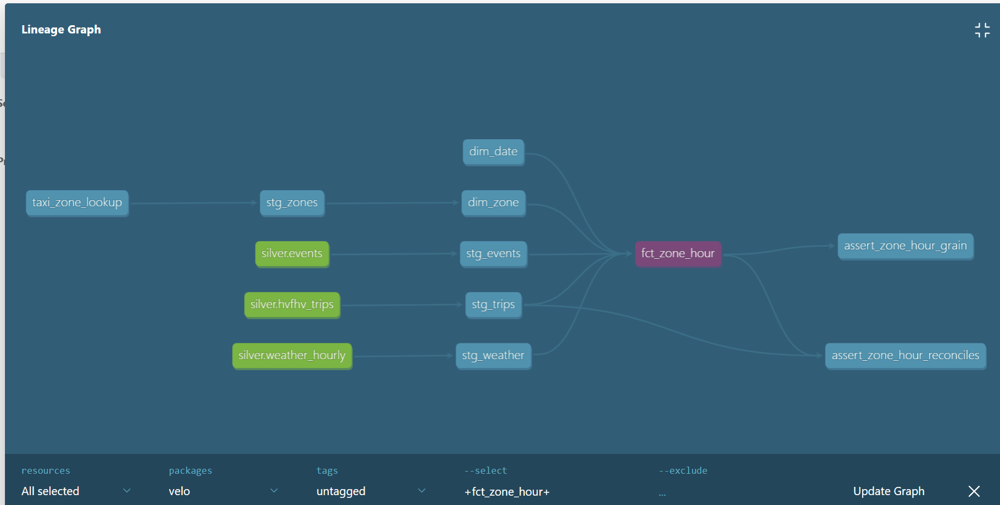
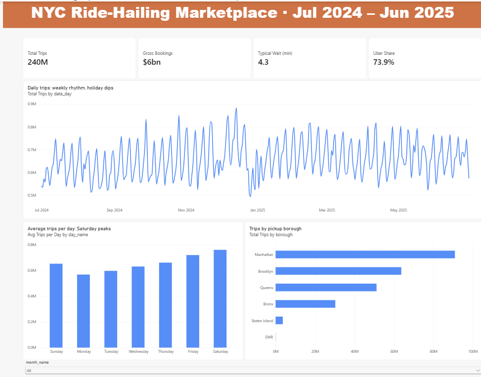
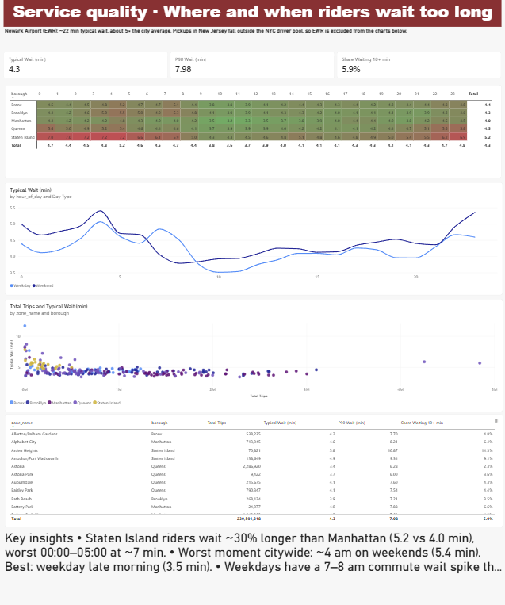
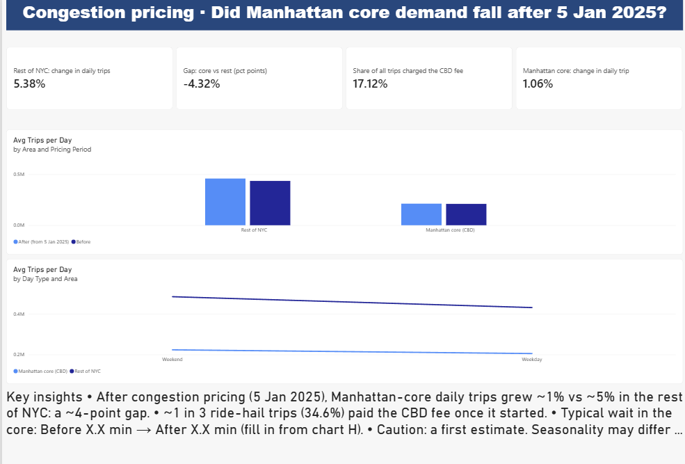
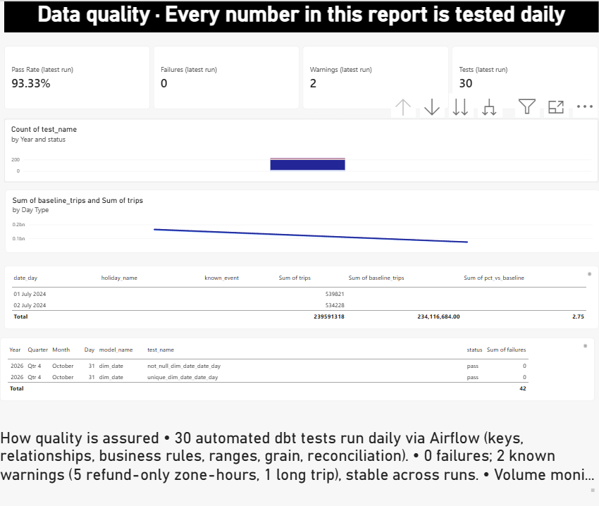

# Velo — Ride-Hailing Marketplace Intelligence Platform

End-to-end data platform on **~240 million real NYC ride-hail trips** (Uber & Lyft, Jul 2024 – Jun 2025): batch and streaming ingestion, a tested lakehouse, data quality monitoring and a business dashboard. It answers where and when riders wait too long, how demand moves, and what congestion pricing did to Manhattan.

**Stack:** Python · Airflow 3 · Databricks (PySpark, Delta Lake, Unity Catalog, Structured Streaming) · dbt · AWS S3/IAM · Kafka · Docker · Power BI

---

## Architecture

```
 NYC TLC trips (parquet)  ─┐
 Open-Meteo weather (API) ─┼─► Airflow ─► Databricks volume ─► BRONZE ─► SILVER ─► GOLD (dbt) ─► Power BI
 NYC permitted events API ─┘     (orchestration)   (Auto Loader)   (clean +     (star schema,
                                                                  quarantine)   30 tests)
 Live ride requests ─► Kafka ─► sink (at-least-once, DLQ) ─► Spark Structured Streaming ─► Delta ─► surge alerts
```

## Headline results

| Area | Result |
|---|---|
| Scale | 239,591,318 trips reconciled exactly at every layer (raw → bronze → silver → gold → dashboard) |
| Data quality | 30 automated tests per daily run: 0 failures; 3 volume anomalies in a year, all explained |
| Streaming | Chaos test with 1% duplicates + 0.2% malformed events: result identical to the clean run; incident drill with 0 loss |
| Service | Staten Island riders wait ~30% longer than Manhattan; Newark Airport is a 5× wait outlier |
| Policy | After congestion pricing, Manhattan-core trips grew ~1% vs ~5% elsewhere (a ~4-point gap, first estimate) |

## Project status

- [x] Phase 0 — Environment setup
- [x] Phase 1 — Ingestion & orchestration
- [x] Phase 2 — Bronze & silver lakehouse
- [x] Phase 3 — Gold layer with dbt
- [x] Phase 4 — Real-time streaming
- [x] Phase 5 — Data quality & monitoring
- [x] Phase 10 — Power BI dashboard
- [ ] Phase 8 — Causal analysis: congestion pricing (difference-in-differences)
- [ ] Phase 7 — Machine learning: demand forecast, wait-time model
- [ ] Phase 6 — Feature store
- [ ] Phase 9 — MLOps: model registry, API, CI/CD
- [ ] Phase 11 — GenAI copilot & board memo

## Repository structure

| Folder | Contents |
|---|---|
| `ingestion/` | Python ingestion: TLC trips, weather API, events API |
| `airflow/` | Airflow 3 (Docker): ingestion DAG, `dbt_quality` DAG, warehouse warm-up script |
| `databricks/` | PySpark notebooks: bronze, silver, performance, streaming |
| `dbt/velo/` | dbt project: staging, marts, monitoring models, tests, macros, seeds |
| `streaming/` | Kafka stack: producer, sink, contract, surge and lag monitors, Docker services |
| `bi/` | Power BI project (`.pbip`, version-controlled as text) |
| `docs/` | Architecture decisions (ADRs), data profile, images |

---

## Phase 0 — Environment setup ✅

- Python 3.11 virtual environment, Git + GitHub, **pre-commit hooks** (ruff lint/format, YAML checks, AWS credential and private key detection).
- **Databricks** Free Edition: Unity Catalog `velo` with `landing`, `bronze`, `silver` and `gold` schemas.
- **AWS**: S3 bucket in eu-north-1 with a dedicated IAM user restricted to that bucket only, a zero-spend budget alert and a lifecycle rule cleaning up incomplete uploads.
- Secrets stay outside the repo (`~/.aws`, `~/.databrickscfg`, `~/.dbt/profiles.yml`; `.env` is gitignored).

## Phase 1 — Ingestion & orchestration ✅

| Source | Volume | Method |
|---|---|---|
| NYC TLC high-volume for-hire trips | 12 months, ~240M rows | Monthly parquet download, validation, upload to S3 and a Databricks volume |
| Open-Meteo hourly weather | 8,760 hours | REST API, NYC coordinates, local time |
| NYC permitted events (Socrata) | 271,471 events | Paginated API (`$limit`/`$offset`/`$order`) with a completeness check against the source count |

- **Airflow 3** in Docker with the TaskFlow API: `pick_month → download → validate → upload_s3 → upload_databricks`, with weather and events in parallel. Retries and timeouts on every task.
- Resilient uploads: adaptive retries, tuned multipart transfers, progress callbacks, atomic file writes.
- **Backfill decision ([ADR 0001](docs/decisions/0001-databricks-direct-ingest.md)):** the laptop → S3 → Databricks route projected ~17 h on home upload speeds; ingesting directly into a Databricks volume loaded 11 months in ~2 minutes.

## Phase 2 — Bronze & silver layers on Databricks ✅

Medallion architecture on Delta Lake, built with PySpark notebooks in `databricks/`.

| Table | Rows | What it is |
|---|---|---|
| `velo.bronze.hvfhv_trips` | 239,600,971 | Raw trips via Auto Loader (`availableNow`, checkpointed) |
| `velo.silver.hvfhv_trips` | 239,591,318 | Cleaned, typed and renamed, with derived metrics (wait, speed, fare per mile, driver take rate) and quality flags |
| `velo.silver.hvfhv_trips_quarantine` | 9,653 | Rows failing hard rules, kept with the reason (not deleted) |
| `velo.silver.weather_hourly` | 8,760 | Hourly NYC weather, one row per hour |
| `velo.silver.events` | 271,471 | NYC permitted events |

- **Reconciliation:** bronze = silver + quarantine, exactly (239,600,971 = 239,591,318 + 9,653).
- **Idempotent ingestion:** re-running Auto Loader added 0 rows (the checkpoint tracks processed files).
- **Performance, measured honestly:** liquid clustering on `pickup_date, pu_location_id` plus Delta stats on the filter columns. A proper benchmark (zone + day filter, 6 dates, warm-up, interleaved runs, median) gave bronze 1.32 s vs silver 1.08 s, i.e. **1.2×**. A naive first run showed 2.8×, but that was a serverless cold-start artefact. At this scale queries are overhead-bound (~1 s) and bronze is already date-ordered, so clustering's benefit would show at larger scale or in bytes scanned rather than wall-clock time.

## Phase 3 — Gold layer with dbt ✅

dbt project (`dbt/velo`) on a Databricks SQL warehouse, building a tested star schema on top of silver.



| Layer | Models | Materialisation |
|---|---|---|
| Sources | `silver.hvfhv_trips`, `silver.weather_hourly`, `silver.events` | Delta tables |
| Seeds | `taxi_zone_lookup` (265 TLC zones), `known_events` | tables |
| Staging | `stg_trips`, `stg_zones`, `stg_weather`, `stg_events` | views |
| Marts | `dim_zone`, `dim_date`, `fct_zone_hour` | tables |

- **`fct_zone_hour`**: one row per pickup zone per hour. 239.6M trips → 2.2M rows (~108× smaller), with demand, median/p90 wait, revenue, weather, events, holiday and congestion-pricing flags.
- **Tests:** unique/not-null keys, referential integrity (trips → zones), a grain test (zone + hour) and a reconciliation test (sum of fact trips = source trip count).
- **Finding:** the uniqueness test on `trip_id` flagged 2,988 colliding keys. Investigation showed all 6,059 rows were distinct trips (99.7% differ in dropoff time, distance and fare): same driver, request and pickup time, so likely multi-rider pickups. Fix: extend the surrogate key rather than delete real trips.

## Phase 4 — Real-time streaming with Kafka ✅

Replays real ride requests as a live event stream and detects demand surges per zone in real time.

```
TLC parquet -> producer.py -> Kafka topic ride_requests (3 partitions) -> surge_monitor.py -> surge alerts
               (60x replay,                                               (5-min event-time windows,
                key = pickup zone)                                         per-partition watermark,
                                                                           baseline from fct_zone_hour)
```

### 4.1–4.3 Kafka, producer and surge monitor

| Component | What it does |
|---|---|
| `streaming/docker-compose.yaml` | Single-node Kafka 3.9 (KRaft mode, no ZooKeeper) |
| `streaming/producer.py` | Replays real requests in their original rhythm; request-time fields only (no future leakage); `acks=all`, backpressure handling |
| `streaming/build_baseline.py` | Exports "normal" demand per zone × weekday × hour from the gold layer via the Databricks SQL connector |
| `streaming/surge_monitor.py` | Tumbling 5-min windows on event time; flags zones ≥2× normal; skips malformed messages |

- **Result:** Friday 14 Mar 2025, 17:00–20:00: 128,068 events processed, 0 late, 0 malformed.
- **Bug found and fixed:** the first version used a global watermark. Kafka only orders events *within* a partition, so reading partition 0 first closed every window early and **71% of events were dropped as late**. Fixed with a per-partition watermark (the minimum of each partition's latest event time), the approach Flink uses.
- **Finding:** 3–5× surges concentrated in Brooklyn's Orthodox Jewish neighbourhoods (Borough Park, Williamsburg, Midwood) and stopped at ~18:45. That date was **Purim**, and on a Friday Shabbat begins at sunset. The baseline only knows US federal holidays, which motivates cultural-calendar features for forecasting.

### 4.4 Kafka → Databricks (Structured Streaming into Delta)

`kafka_to_volume.py` is an **at-least-once sink** (offsets committed only after a successful upload), landing 10-second JSON files in a Unity Catalog volume. `databricks/06_stream_surge.py` reads them with Auto Loader as a stream, applies 5-minute event-time windows with a 10-minute watermark, writes `velo.silver.stream_zone_5min` and exposes `velo.gold.stream_surge_alerts`.

- **Stream–batch reconciliation:** streaming output = batch truth for every closed window (117,227 requests, 33 windows, 0 lost). Surges match the local monitor exactly.
- **Lessons:** a backlog replay is not live (it produced up to 1.5 h of event-time disorder, and Spark's global watermark dropped 8.6% of events; a live sink reduced disorder to ≤1 s). Watermark size trades latency for completeness. The output table and its checkpoint are a pair and must be reset together.

### 4.5 Data contract, dead-letter queue, idempotency (chaos-tested)

- `streaming/contract.py`: every event must have `event_id`, `schema_version`, a valid ISO `event_time`, a known company and zones 1–265. Failures return a specific reason.
- Invalid events go to `ride_requests_dlq` with the error, raw payload and source partition/offset. Offsets are committed only after the upload **and** the DLQ writes succeed.
- A deterministic `event_id` plus `dropDuplicatesWithinWatermark(event_id)` in Spark makes processing idempotent.

| Chaos test | Result |
|---|---|
| Messages sent | 129,604 = 128,068 real + 1,280 duplicates + 256 malformed |
| Routed to DLQ | 256 / 256 (5 failure types) |
| Unique events after dedupe | 128,068 |
| Streaming result | 117,227 requests in 33 windows, **identical to the clean run** |

### 4.6–4.7 Observability and containerised services

- **Consumer lag monitor** (`streaming/lag_monitor.py`): alerts only when lag is above 10k **and** growing for 3 checks, with hysteresis (recovered below 1k, DRAINING in between). On the same incident, the old rule (5k, no hysteresis) flapped 4 times; the new one went ALERT → DRAINING → RECOVERED cleanly.
- **Docker services:** Kafka (two listeners, healthcheck), `sink` and `lag-monitor` (`restart: unless-stopped`), `producer` (on-demand). One image, pinned versions, credentials mounted read-only.
- **Incident drill:** the sink container was stopped mid-stream; lag climbed to 34,654 → ALERT; after restart, one catch-up upload of **exactly 34,654** events → RECOVERED. No loss, no duplicates.
- **Bug found:** Kafka wrote to `/tmp/kraft-combined-logs`, not the mounted volume, so topics vanished when the container was recreated. Fixed with `KAFKA_LOG_DIRS` and verified with `--force-recreate`.

## Phase 5 — Data quality & monitoring ✅

- **5.1 Business-rule and range tests** (`dbt_utils`; failing rows saved by `store_failures`): CBD fee only on trips ending after 5 Jan 2025, fee trips ≤ total trips, Uber + Lyft = all trips, plausible ranges for waits, shares and temperature. `warn` for "unusual but possible", `error` for "impossible".
  - **Finding:** an hourly version of the CBD rule failed on 157 zone-hours, all on the evening of 4 Jan 2025: trips picked up before midnight that entered the zone after it were legitimately charged. Moved to trip level (dropoff time), it passed on all 240M trips. The rule was wrong, not the data.
- **5.2 Volume anomaly detection** (`dq_daily_volume`): daily trips vs the same weekday over the previous 4 weeks; anomaly if more than 25% off. One year produced 3 anomalies (Christmas Day, 26–27 Dec). Completeness was verified (24 hours, ~258 zones present), confirming a real-world holiday-week drop, then annotated in a version-controlled `known_events` seed.
- **5.3 DQ history** (`dq_test_history`): an `on-run-end` macro logs every test result per run, the basis for quality-over-time reporting.
- **5.4 Orchestration** (`airflow/dags/dbt_quality.py`): daily `warm_warehouse → dbt_deps → dbt_build → dq_summary`, with dbt in an isolated venv inside a custom Airflow image.
  - **Self-healing:** early runs failed on warehouse cold starts. Added a warm-up task, exponential-backoff retries (2/4/8 min), `max_active_runs=1` and a failure-alert callback. In the next incident the warm-up failed 3 times on capacity and succeeded on try 4 with no manual action.
- Freshness checks were deliberately omitted: the dataset is historical (ends Jun 2025), so recency tests would always fail.

## Phase 10 — Power BI dashboard ✅

Power BI report on the gold star schema (Import mode from the Databricks SQL warehouse), saved as a **Power BI Project (`.pbip`)** in `bi/`, so the report and model are version-controlled as text. Trip-weighted DAX measures (a simple average of zone-hour medians would over-weight quiet zones).

### 1. Marketplace overview


- 239,591,318 trips (matches dbt exactly); Uber holds a 73.9% share.
- Saturday is the busiest day (~33% above Monday): demand is leisure-driven, not commute-driven.
- The outer boroughs together out-trip Manhattan; ride-hail is not a Manhattan-only product.

### 2. Service quality


- Staten Island riders wait ~30% longer than Manhattan (5.2 vs 4.0 min), worst 00:00–05:00 at ~7 min.
- The worst moment citywide is ~4 am on weekends (5.4 min); weekdays add a 7–8 am commute spike.
- Newark Airport is a 5× outlier (~22 min typical wait, 61% wait 10+ min): a supply gap, shown as an explicit callout so it doesn't distort the charts.

### 3. Congestion pricing (from 5 Jan 2025)


- Manhattan-core daily trips grew 1.1% vs 5.4% in the rest of NYC: a **4.3-point gap**.
- About 1 in 3 ride-hail trips (34.6%) paid the CBD fee once it started.
- A first estimate only: seasonality may differ between areas, so Phase 8 tests it with difference-in-differences.

### 4. Data quality


- 30 automated tests per daily Airflow run: 0 failures, 2 known and stable warnings.
- Volume monitor: 3 anomalous days in a year, all explained (Christmas week) and annotated.
