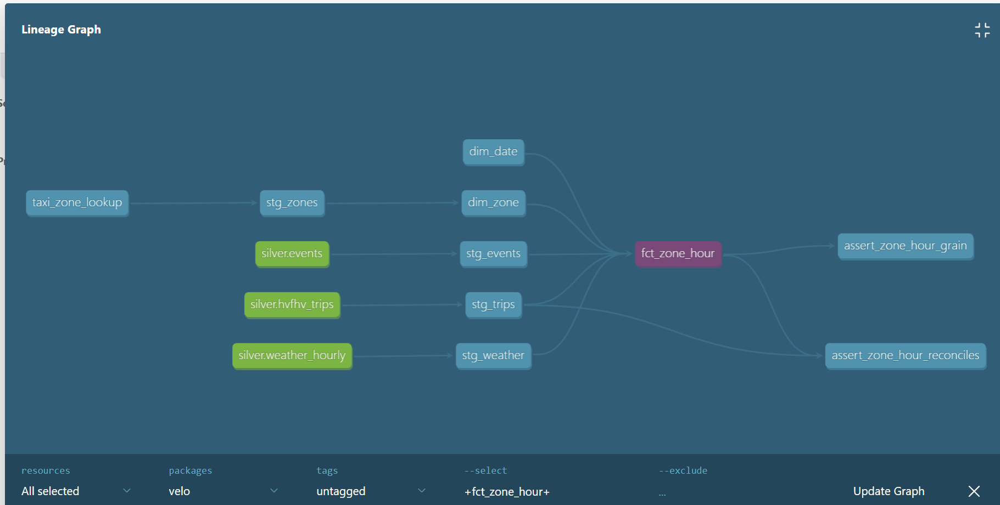

# Velo — Ride-Hailing Marketplace Intelligence Platform

End-to-end data platform that quantifies revenue lost to supply–demand mismatch in a ride-hailing marketplace, using ~20M real NYC TLC trips per month.

**Stack:** Airflow · Databricks (PySpark, Delta Lake, Unity Catalog) · dbt · AWS · Kafka · MLflow · Power BI

## Status
- [x] Phase 0 — Environment setup (Databricks, AWS S3/IAM, pre-commit, smoke test)
- [x] Phase 1 — Ingestion: 12 months of NYC HVFHV trips (~240M rows), hourly weather (Open-Meteo API), permitted events (NYC Open Data, paginated); orchestrated in Airflow 3
- [ ] Phase 2 — Lakehouse (bronze/silver) with PySpark + Delta
- [ ] Phase 3 — dbt modelling (gold)

## Phase 3 — Gold layer with dbt ✅

dbt project (`dbt/velo`) on Databricks SQL Warehouse, building a tested star schema on top of the silver Delta tables.



| Layer | Models | Materialisation |
|---|---|---|
| Sources | `silver.hvfhv_trips`, `silver.weather_hourly`, `silver.events` | Delta tables |
| Seed | `taxi_zone_lookup` (265 TLC zones) | table |
| Staging | `stg_trips`, `stg_zones`, `stg_weather`, `stg_events` | views |
| Marts | `dim_zone`, `dim_date`, `fct_zone_hour` | tables |

**`fct_zone_hour`**: one row per pickup zone per hour. 239.6M trips → 2.2M rows (~108× smaller), with demand, median/p90 wait, revenue, weather, events, holiday and congestion-pricing flags.

**Data tests (19):** unique / not_null keys, referential integrity (trips → zones), a custom grain test (zone + hour) and a reconciliation test (sum of fact trips = source trip count).

**Finding:** the uniqueness test on `trip_id` flagged 2,988 colliding keys. Investigation showed all 6,059 rows were distinct trips (99.7% differ in dropoff time, distance and fare): same driver, request and pickup time, so likely multi-rider pickups. Fix: extend the surrogate key, rather than deleting real trips.

## Phase 4 — Real-time streaming with Kafka 🚧

Replays real ride requests as a live event stream and detects demand surges per zone in real time.

## Phase 4 — Real-time streaming with Kafka

Replays real ride requests as a live event stream and detects demand surges per zone in real time.

```
TLC parquet -> producer.py -> Kafka topic ride_requests (3 partitions) -> surge_monitor.py -> surge alerts
               (60x replay,                                               (5-min event-time windows,
                key = pickup zone)                                         per-partition watermark,
                                                                           baseline from fct_zone_hour)
```

| Component | What it does |
|---|---|
| `streaming/docker-compose.yaml` | Single-node Kafka 3.9 (KRaft mode, no ZooKeeper) |
| `streaming/producer.py` | Replays real requests in their original rhythm; only request-time fields (no future leakage); `acks=all`, backpressure handling |
| `streaming/build_baseline.py` | Exports "normal" demand per zone × weekday × hour from the dbt gold table via the Databricks SQL connector |
| `streaming/surge_monitor.py` | Tumbling 5-min windows on event time; flags zones ≥2× normal; skips malformed messages; saves every window to CSV |

**Result:** Friday 14 Mar 2025, 17:00–20:00, 128,068 events processed, 0 late, 0 malformed.

**Bug found and fixed:** the first version used a global watermark (latest event time across all partitions). Because Kafka only orders events *within* a partition, reading partition 0 first closed every window early, and **71% of events were dropped as late**. Fixed with a per-partition watermark (the minimum of each partition's latest event time), the same approach Spark and Flink use.

**Finding:** surges of 3–5× concentrated in Brooklyn's Orthodox Jewish neighbourhoods (Borough Park, Williamsburg, Midwood) and stopped at around 18:45. That date was **Purim**, and on a Friday Shabbat begins at sunset. The baseline only knows US federal holidays, which motivates cultural-calendar features in the forecasting model.
### Phase 4.4 — Kafka → Databricks (Structured Streaming into Delta)

`kafka_to_volume.py` is an at-least-once sink (offsets committed only after a successful upload), landing 10-second JSON files in a Unity Catalog volume. `databricks/06_stream_surge.py` reads them with Auto Loader as a stream, applies 5-minute event-time windows with a 10-minute watermark, writes `velo.silver.stream_zone_5min` (Delta) and exposes `velo.gold.stream_surge_alerts`.

**Stream–batch reconciliation:** streaming output = batch truth for every closed window (117,227 requests, 33 windows, 0 lost). Surges match the local Python monitor exactly.

**Lessons learned:**
- **Backlog replay ≠ live.** Sinking a pre-filled topic produced files with up to 1.5 h of event-time disorder, and Spark's *global* watermark dropped 8.6% of events. Running the sink live reduced the disorder to ≤1 s.
- **Watermark sizing = latency vs completeness.** 10 min tolerates live disorder; the cost is that results arrive 10 min late, and about 1,400 window states are held in memory.
- **Table and checkpoint are a pair.** Dropping the table without its checkpoint made the stream skip all data (the checkpoint said "already processed").
### Phase 4.5 — Data contract, dead-letter queue, idempotency (chaos-tested)

- `streaming/contract.py`: every event must have `event_id`, `schema_version`, a valid ISO `event_time`, a known company and zones 1–265. Failures return a specific reason.
- The sink routes invalid events to `ride_requests_dlq` with the error, raw payload and source partition/offset. Offsets are committed only after the upload **and** the DLQ writes succeed.
- The producer emits a deterministic `event_id`; Spark applies `dropDuplicatesWithinWatermark(event_id)` before windowing.

**Chaos test:** the producer re-sent 1 in 100 events (simulated retries) and injected 1 malformed event per 500 (5 failure types).

| | Result |
|---|---|
| Messages sent | 129,604 = 128,068 real + 1,280 duplicates + 256 malformed |
| Routed to DLQ | 256 / 256 (52 invalid JSON, 51 missing field, 51 bad zone, 51 bad timestamp, 51 unknown company) |
| Unique events after dedupe | 128,068 |
| Streaming result | 117,227 requests in 33 closed windows, **identical to the clean run**, 0 difference per window vs batch truth |
### Phase 4.6–4.7 — Observability and containerised services

**Consumer lag monitor** (`streaming/lag_monitor.py`): lag = latest offset − committed offset per partition. It alerts only when lag is above 10k **and** growing for 3 checks, with hysteresis (recovered below 1k, DRAINING in between).
- A side-by-side run with the old rule (5k threshold, no hysteresis) on the same incident: the old rule flapped HIGH↔RECOVERED 4 times; the new one went ALERT → DRAINING → RECOVERED cleanly. The threshold is set above normal lag (rate × commit interval ≈ 7k).

**Docker services** (`streaming/docker-compose.yaml`): Kafka (two listeners, `localhost:9092` for the laptop and `kafka:29092` for containers, plus a healthcheck), plus `sink` and `lag-monitor` (`restart: unless-stopped`), plus `producer` (an on-demand profile). One image, pinned library versions, credentials mounted read-only (never baked into the image).

**Incident drill:** the producer replayed 41,851 events; the sink container was stopped mid-stream. Lag climbed to 34,654 → ALERT; the sink was restarted → one catch-up upload of **exactly 34,654** events → RECOVERED. No loss, no duplicates.

**Bug found:** the Kafka volume was mounted at `/var/lib/kafka/data`, but the image writes to `/tmp/kraft-combined-logs` by default, so topics vanished when the container was recreated. Fixed with `KAFKA_LOG_DIRS` and verified with `--force-recreate`.


## Phase 2 — Bronze & silver layers on Databricks ✅

Medallion architecture on Delta Lake (Unity Catalog `velo`), built with PySpark notebooks in `databricks/`.

| Table | Rows | What it is |
|---|---|---|
| `velo.bronze.hvfhv_trips` | 239,600,971 | Raw HVFHV trips (Jul 2024 – Jun 2025) via Auto Loader (`availableNow`, checkpointed) |
| `velo.silver.hvfhv_trips` | 239,591,318 | Cleaned, typed and renamed, with derived metrics (wait, speed, fare per mile, driver take rate) and quality flags |
| `velo.silver.hvfhv_trips_quarantine` | 9,653 | Rows failing hard rules, kept with the reason (not deleted) |
| `velo.silver.weather_hourly` | 8,760 | Hourly NYC weather (Open-Meteo), one row per hour |
| `velo.silver.events` | 271,471 | NYC permitted events (Socrata API, paginated, with a completeness check) |

**Engineering highlights**
- **Reconciliation:** bronze = silver + quarantine, exactly (239,600,971 = 239,591,318 + 9,653).
- **Idempotent ingestion:** re-running Auto Loader added 0 rows (the checkpoint tracks processed files).
- - **Performance (measured honestly):** liquid clustering on `pickup_date, pu_location_id` plus Delta stats on the filter columns. Benchmark (zone + day filter, 6 dates, warm-up, interleaved, median): bronze 1.32 s vs silver 1.08 s, **1.2×**. A naive first run showed 2.8×, but that was a serverless cold-start artefact. At this scale queries are overhead-bound (~1 s) and bronze is already date-ordered from monthly loads, so clustering's benefit would show at larger scale or in bytes scanned, not wall-clock time.
- **Backfill decision (ADR 0001):** a laptop → S3 → Databricks backfill projected ~17 h on home upload speeds; switching to direct ingestion into a Databricks volume loaded 11 months in ~2 minutes. See `docs/decisions/0001-databricks-direct-ingest.md`.
## Phase 5 — Data quality & monitoring ✅

**5.1 Business-rule and range tests** (`dbt_utils`, `store_failures: true` saves failing rows to `gold_dbt_test__audit`).
- Rules: CBD fee only on trips ending after 5 Jan 2025, fee trips ≤ total trips, Uber + Lyft = all trips, plausible ranges for waits, shares and temperature. `warn` for "unusual but possible", `error` for "impossible".
- **Finding:** an hourly version of the CBD rule failed on 157 zone-hours, all on the evening of 4 Jan 2025. Trips picked up before midnight that entered the zone after it were legitimately charged. The rule was moved to trip level (dropoff time) and passed on all 240M trips, so the rule was wrong, not the data.

**5.2 Volume anomaly detection** (`dq_daily_volume`): daily trips vs the same weekday over the previous 4 weeks; anomaly if more than 25% off.
- One year produced 3 anomalies: Christmas Day (a holiday) and 26–27 Dec (−31%, −27%). Completeness was verified (all 24 hours, about 258 zones present), confirming a real-world holiday-week drop, then annotated in a version-controlled `known_events` seed so it no longer warns.

**5.3 DQ history** (`dq_test_history`): an `on-run-end` macro logs every test result (status, failures, timing, model) per run, which is the basis for a quality-over-time dashboard.

**5.4 Orchestration** (`airflow/dags/dbt_quality.py`): daily `warm_warehouse → dbt_deps → dbt_build → dq_summary`, with dbt in an isolated venv inside a custom Airflow image and credentials mounted read-only.
- Self-healing: the first runs failed on warehouse cold starts (`Cannot create the resource`). I added a warm-up task (start the warehouse and wait until RUNNING), exponential-backoff retries (2/4/8 min), `max_active_runs=1` and a failure-alert callback. In the next incident the warm-up failed 3 times on capacity and succeeded on try 4 with no manual action.

*Freshness checks were deliberately omitted: the dataset is historical (ends Jun 2025), so recency tests would always fail.*
