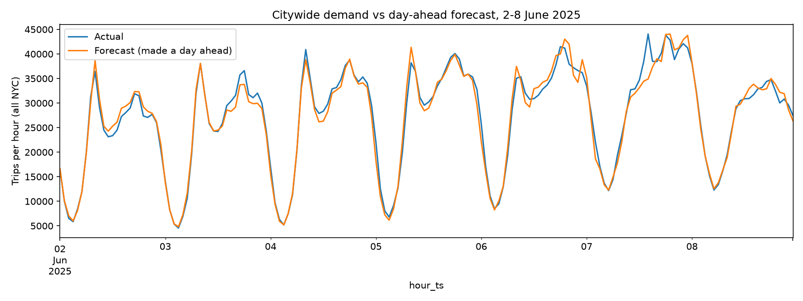
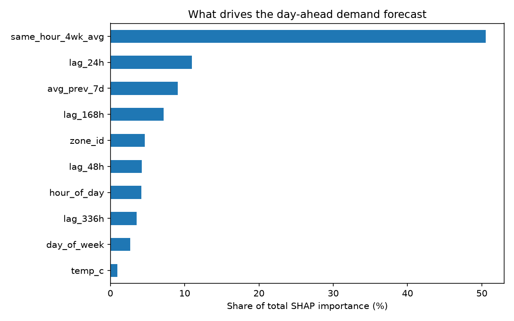
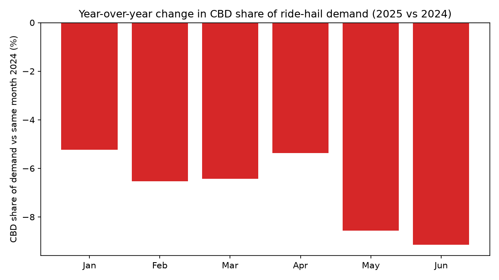
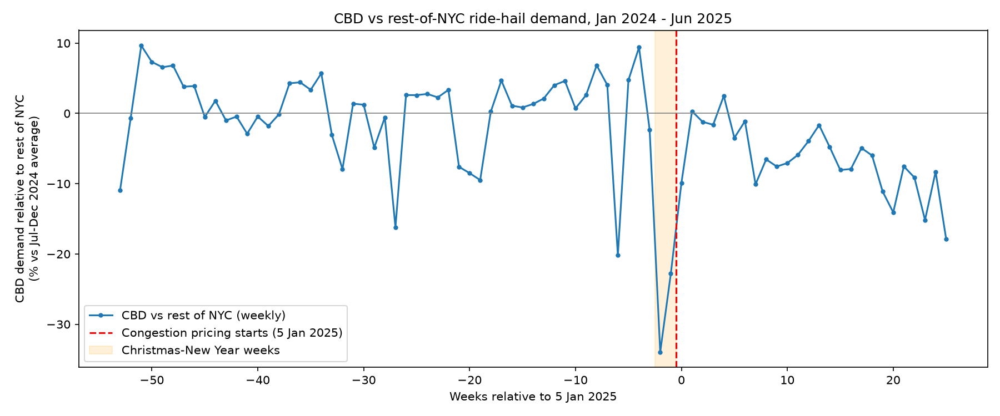
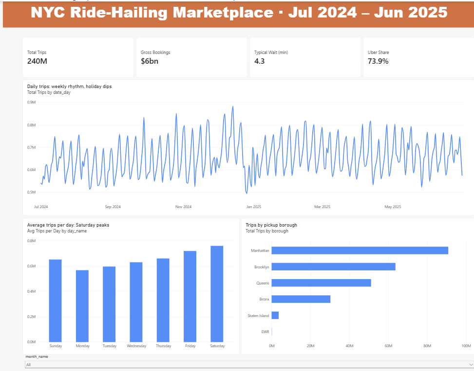
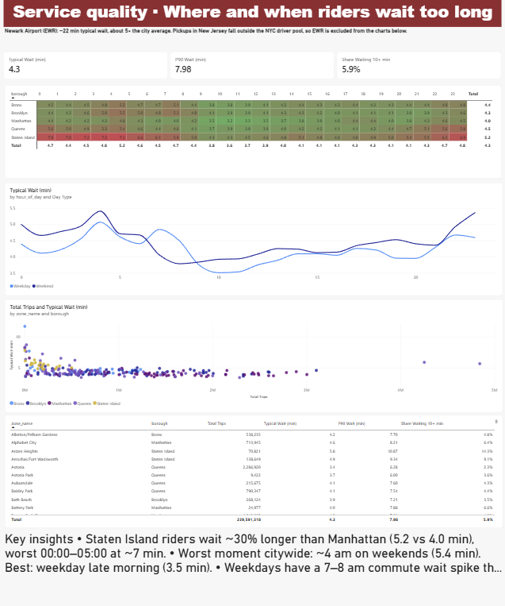
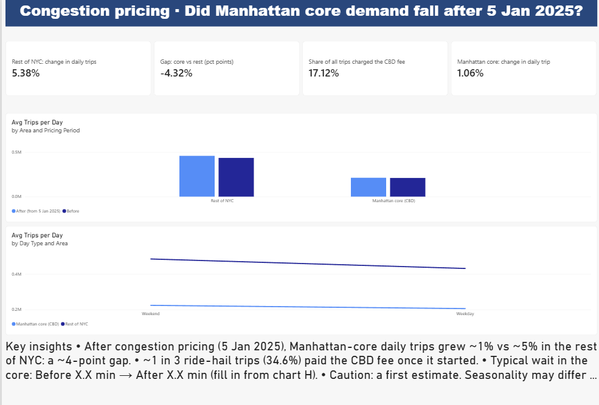
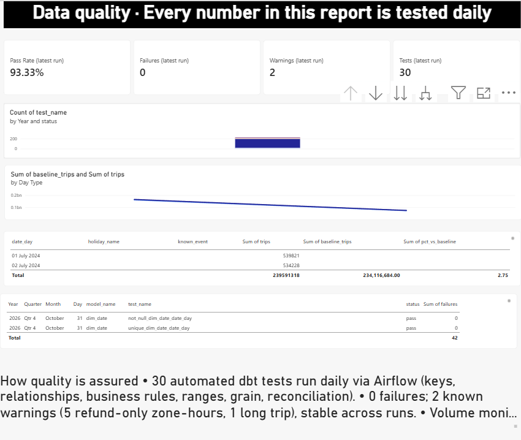

# Velo — Ride-Hailing Marketplace Intelligence Platform

[](https://github.com/dhimanvivek0001/velo/actions/workflows/ci.yml)

End-to-end data platform on **360 million real NYC ride-hail trips** (Uber & Lyft, Jan 2024 – Jun 2025): batch and streaming ingestion, a tested lakehouse, data quality monitoring, a business dashboard, a causal policy evaluation, and a day-ahead demand forecast served through a tested API with a feature store, model registry, CI and monitoring. It answers where and when riders wait too long, how demand moves, and what congestion pricing did to Manhattan.

**Stack:** Python · Airflow 3 · Databricks (PySpark, Delta Lake, Unity Catalog, Structured Streaming) · dbt · AWS S3/IAM · Kafka · Docker · Power BI · statsmodels · LightGBM · MLflow · FastAPI · GitHub Actions

---

## Architecture

```
 NYC TLC trips (parquet)  ─┐
 Open-Meteo weather (API) ─┼─► Airflow ─► Databricks volume ─► BRONZE ─► SILVER ─► GOLD (dbt) ─► Power BI
 NYC permitted events API ─┘     (orchestration)   (Auto Loader)   (clean +     (star schema,
                                                                  quarantine)   30 tests)
 Live ride requests ─► Kafka ─► sink (at-least-once, DLQ) ─► Spark Structured Streaming ─► Delta ─► surge alerts
```

## Headline results

| Area | Result |
|---|---|
| **Policy impact** | **Congestion pricing cut ride-hail pickups in the charging zone by 6.8% (95% CI 4.9–8.7%): ~12,300 fewer per day.** Robust to seasonal, year-over-year, placebo and donut checks |
| Scale | 360,465,639 raw trips reconciled exactly at every layer (raw → bronze → silver + quarantine → gold) |
| Data quality | 30 automated tests per daily run: 0 failures; volume anomalies all explained |
| Streaming | Chaos test with 1% duplicates + 0.2% malformed events: result identical to the clean run; incident drill with 0 loss |
| Forecasting | Day-ahead zone-hour demand model (LightGBM, Poisson): 9% less error than a 4-week rule on unseen months (WAPE 12.3% vs 13.6%); holiday error cut by a third |
| MLOps | Model registry with a written promotion gate (challenger blocked), FastAPI serving from an online feature store, 8 tests incl. a training–serving skew test, CI green on every push, daily accuracy / drift / completeness monitoring |
| Feature store | 5 time-stamped feature tables in Unity Catalog; point-in-time training set reproduces the Phase 7 data with 0 differences across 3.26M rows; a hidden date-fingerprint feature caught and fixed |
| Service | Staten Island riders wait ~30% longer than Manhattan; Newark Airport is a 5× wait outlier |

## Project status

- [x] Phase 0 — Environment setup
- [x] Phase 1 — Ingestion & orchestration
- [x] Phase 2 — Bronze & silver lakehouse
- [x] Phase 3 — Gold layer with dbt
- [x] Phase 4 — Real-time streaming
- [x] Phase 5 — Data quality & monitoring
- [x] Phase 10 — Power BI dashboard
- [x] Phase 8 — Causal analysis: congestion pricing (difference-in-differences)
- [x] Phase 7 — Machine learning: day-ahead demand forecast
- [x] Phase 6 — Feature store (point-in-time, built on Phase 7's findings)
- [x] Phase 9 — MLOps: model registry, API, tests, CI/CD, monitoring
- [ ] Phase 11 — GenAI copilot & board memo

## Repository structure

| Folder | Contents |
|---|---|
| `ingestion/` | Python ingestion: TLC trips, weather API, events API |
| `airflow/` | Airflow 3 (Docker): ingestion DAG, `dbt_quality` DAG, warehouse warm-up script |
| `databricks/` | PySpark notebooks: bronze, silver, performance, streaming |
| `dbt/velo/` | dbt project: staging, marts, monitoring, causal, ML and feature-store models, tests, macros, seeds |
| `analysis/` | Causal analysis: difference-in-differences, event study, robustness checks |
| `forecasting/` | Demand forecasting: baselines, LightGBM training (MLflow), evaluation, SHAP, feature-store ablation (`train_fs.py`) |
| `serving/` | FastAPI forecast API, online feature store sync, daily model monitoring |
| `tests/` | pytest: API contract tests (fixture model) and training–serving skew test |
| `.github/workflows/` | CI: pre-commit hooks, API tests, dbt parse on every push |
| `streaming/` | Kafka stack: producer, sink, contract, surge and lag monitors, Docker services |
| `bi/` | Power BI project (`.pbip`, version-controlled as text) |
| `docs/` | Architecture decisions (ADRs), data profile, images |

---

## Phase 0 — Environment setup ✅

- Python 3.11 virtual environment, Git + GitHub, **pre-commit hooks** (ruff lint/format, YAML checks, AWS credential and private key detection).
- **Databricks** Free Edition: Unity Catalog `velo` with `landing`, `bronze`, `silver` and `gold` schemas.
- **AWS**: S3 bucket in eu-north-1 with a dedicated IAM user restricted to that bucket only, a zero-spend budget alert and a lifecycle rule cleaning up incomplete uploads.
- Secrets stay outside the repo (`~/.aws`, `~/.databrickscfg`, `~/.dbt/profiles.yml`; `.env` is gitignored).

## Phase 1 — Ingestion & orchestration ✅

| Source | Volume | Method |
|---|---|---|
| NYC TLC high-volume for-hire trips | 18 months (Jan 2024 – Jun 2025), ~360M rows | Monthly parquet download, validation, upload to S3 and a Databricks volume |
| Open-Meteo hourly weather | 8,760 hours | REST API, NYC coordinates, local time |
| NYC permitted events (Socrata) | 271,471 events | Paginated API (`$limit`/`$offset`/`$order`) with a completeness check against the source count |

- **Airflow 3** in Docker with the TaskFlow API: `pick_month → download → validate → upload_s3 → upload_databricks`, with weather and events in parallel. Retries and timeouts on every task.
- Resilient uploads: adaptive retries, tuned multipart transfers, progress callbacks, atomic file writes.
- **Backfill decision ([ADR 0001](docs/decisions/0001-databricks-direct-ingest.md)):** the laptop → S3 → Databricks route projected ~17 h on home upload speeds; ingesting directly into a Databricks volume loaded 11 months in ~2 minutes.
- **Extending history was a re-run, not a rebuild:** Jan–Jun 2024 was added later for the causal analysis by widening the backfill window. The idempotent backfill skipped existing months and Auto Loader's checkpoint read only the 6 new files.
- Weather and events cover Jul 2024 onwards; Jan–Jun 2024 trips have no weather context (not needed by the causal analysis).

## Phase 2 — Bronze & silver layers on Databricks ✅

Medallion architecture on Delta Lake, built with PySpark notebooks in `databricks/`.

| Table | Rows | What it is |
|---|---|---|
| `velo.bronze.hvfhv_trips` | 360,465,639 | Raw trips via Auto Loader (`availableNow`, checkpointed) |
| `velo.silver.hvfhv_trips` | 360,455,986 | Cleaned, typed and renamed, with derived metrics (wait, speed, fare per mile, driver take rate) and quality flags |
| `velo.silver.hvfhv_trips_quarantine` | 9,653 | Rows failing hard rules, kept with the reason (not deleted) |
| `velo.silver.weather_hourly` | 8,760 | Hourly NYC weather, one row per hour |
| `velo.silver.events` | 271,471 | NYC permitted events |

- **Reconciliation:** bronze = silver + quarantine, exactly (360,465,639 = 360,455,986 + 9,653).
- **Investigated a "too clean" result:** adding 120.9M rows added zero quarantined rows. All 9,653 quarantined rows turned out to come from one event, the daylight-saving fall-back on 3 Nov 2024, when the repeated 1 am hour makes local-time trips look negative. Spring-forward changes don't cause that, so zero new quarantine was correct. A passing reconciliation proves nothing was lost, not that every row is in the right table, so that was verified separately.
- **Idempotent ingestion:** re-running Auto Loader added 0 rows (the checkpoint tracks processed files).
- **Performance, measured honestly:** liquid clustering on `pickup_date, pu_location_id` plus Delta stats on the filter columns. A proper benchmark (zone + day filter, 6 dates, warm-up, interleaved runs, median) gave bronze 1.32 s vs silver 1.08 s, i.e. **1.2×**. A naive first run showed 2.8×, but that was a serverless cold-start artefact. At this scale queries are overhead-bound (~1 s) and bronze is already date-ordered, so clustering's benefit would show at larger scale or in bytes scanned rather than wall-clock time.

## Phase 3 — Gold layer with dbt ✅

dbt project (`dbt/velo`) on a Databricks SQL warehouse, building a tested star schema on top of silver.


| Layer | Models | Materialisation |
|---|---|---|
| Sources | `silver.hvfhv_trips`, `silver.weather_hourly`, `silver.events` | Delta tables |
| Seeds | `taxi_zone_lookup` (265 TLC zones), `known_events` | tables |
| Staging | `stg_trips`, `stg_zones`, `stg_weather`, `stg_events` | views |
| Marts | `dim_zone`, `dim_date`, `fct_zone_hour` | tables |

- **`fct_zone_hour`**: one row per pickup zone per hour, with demand, median/p90 wait, revenue, weather, events, holiday and congestion-pricing flags (the 12-month version reduced 239.6M trips to 2.2M rows, ~108× smaller).
- **Tests:** unique/not-null keys, referential integrity (trips → zones), a grain test (zone + hour) and a reconciliation test (sum of fact trips = source trip count).
- **Finding:** the uniqueness test on `trip_id` flagged 2,988 colliding keys. Investigation showed all 6,059 rows were distinct trips (99.7% differ in dropoff time, distance and fare): same driver, request and pickup time, so likely multi-rider pickups. Fix: extend the surrogate key rather than delete real trips.

## Phase 4 — Real-time streaming with Kafka ✅

Replays real ride requests as a live event stream and detects demand surges per zone in real time.

```
TLC parquet -> producer.py -> Kafka topic ride_requests (3 partitions) -> surge_monitor.py -> surge alerts
               (60x replay,                                               (5-min event-time windows,
                key = pickup zone)                                         per-partition watermark,
                                                                           baseline from fct_zone_hour)
```

### 4.1–4.3 Kafka, producer and surge monitor

| Component | What it does |
|---|---|
| `streaming/docker-compose.yaml` | Single-node Kafka 3.9 (KRaft mode, no ZooKeeper) |
| `streaming/producer.py` | Replays real requests in their original rhythm; request-time fields only (no future leakage); `acks=all`, backpressure handling |
| `streaming/build_baseline.py` | Exports "normal" demand per zone × weekday × hour from the gold layer via the Databricks SQL connector |
| `streaming/surge_monitor.py` | Tumbling 5-min windows on event time; flags zones ≥2× normal; skips malformed messages |

- **Result:** Friday 14 Mar 2025, 17:00–20:00: 128,068 events processed, 0 late, 0 malformed.
- **Bug found and fixed:** the first version used a global watermark. Kafka only orders events *within* a partition, so reading partition 0 first closed every window early and **71% of events were dropped as late**. Fixed with a per-partition watermark (the minimum of each partition's latest event time), the approach Flink uses.
- **Finding:** 3–5× surges concentrated in Brooklyn's Orthodox Jewish neighbourhoods (Borough Park, Williamsburg, Midwood) and stopped at ~18:45. That date was **Purim**, and on a Friday Shabbat begins at sunset. The baseline only knows US federal holidays, which motivates cultural-calendar features for forecasting.

### 4.4 Kafka → Databricks (Structured Streaming into Delta)

`kafka_to_volume.py` is an **at-least-once sink** (offsets committed only after a successful upload), landing 10-second JSON files in a Unity Catalog volume. `databricks/06_stream_surge.py` reads them with Auto Loader as a stream, applies 5-minute event-time windows with a 10-minute watermark, writes `velo.silver.stream_zone_5min` and exposes `velo.gold.stream_surge_alerts`.

- **Stream–batch reconciliation:** streaming output = batch truth for every closed window (117,227 requests, 33 windows, 0 lost). Surges match the local monitor exactly.
- **Lessons:** a backlog replay is not live (it produced up to 1.5 h of event-time disorder, and Spark's global watermark dropped 8.6% of events; a live sink reduced disorder to ≤1 s). Watermark size trades latency for completeness. The output table and its checkpoint are a pair and must be reset together.

### 4.5 Data contract, dead-letter queue, idempotency (chaos-tested)

- `streaming/contract.py`: every event must have `event_id`, `schema_version`, a valid ISO `event_time`, a known company and zones 1–265. Failures return a specific reason.
- Invalid events go to `ride_requests_dlq` with the error, raw payload and source partition/offset. Offsets are committed only after the upload **and** the DLQ writes succeed.
- A deterministic `event_id` plus `dropDuplicatesWithinWatermark(event_id)` in Spark makes processing idempotent.

| Chaos test | Result |
|---|---|
| Messages sent | 129,604 = 128,068 real + 1,280 duplicates + 256 malformed |
| Routed to DLQ | 256 / 256 (5 failure types) |
| Unique events after dedupe | 128,068 |
| Streaming result | 117,227 requests in 33 windows, **identical to the clean run** |

### 4.6–4.7 Observability and containerised services

- **Consumer lag monitor** (`streaming/lag_monitor.py`): alerts only when lag is above 10k **and** growing for 3 checks, with hysteresis (recovered below 1k, DRAINING in between). On the same incident, the old rule (5k, no hysteresis) flapped 4 times; the new one went ALERT → DRAINING → RECOVERED cleanly.
- **Docker services:** Kafka (two listeners, healthcheck), `sink` and `lag-monitor` (`restart: unless-stopped`), `producer` (on-demand). One image, pinned versions, credentials mounted read-only.
- **Incident drill:** the sink container was stopped mid-stream; lag climbed to 34,654 → ALERT; after restart, one catch-up upload of **exactly 34,654** events → RECOVERED. No loss, no duplicates.
- **Bug found:** Kafka wrote to `/tmp/kraft-combined-logs`, not the mounted volume, so topics vanished when the container was recreated. Fixed with `KAFKA_LOG_DIRS` and verified with `--force-recreate`.

## Phase 5 — Data quality & monitoring ✅

- **5.1 Business-rule and range tests** (`dbt_utils`; failing rows saved by `store_failures`): CBD fee only on trips ending after 5 Jan 2025, fee trips ≤ total trips, Uber + Lyft = all trips, plausible ranges for waits, shares and temperature. `warn` for "unusual but possible", `error` for "impossible".
  - **Finding:** an hourly version of the CBD rule failed on 157 zone-hours, all on the evening of 4 Jan 2025: trips picked up before midnight that entered the zone after it were legitimately charged. Moved to trip level (dropoff time), it passed on all 240M trips. The rule was wrong, not the data.
- **5.2 Volume anomaly detection** (`dq_daily_volume`): daily trips vs the same weekday over the previous 4 weeks; anomaly if more than 25% off. One year produced 3 anomalies (Christmas Day, 26–27 Dec). Completeness was verified (24 hours, ~258 zones present), confirming a real-world holiday-week drop, then annotated in a version-controlled `known_events` seed.
- **5.3 DQ history** (`dq_test_history`): an `on-run-end` macro logs every test result per run, the basis for quality-over-time reporting.
- **5.4 Orchestration** (`airflow/dags/dbt_quality.py`): daily `warm_warehouse → dbt_deps → dbt_build → dq_summary`, with dbt in an isolated venv inside a custom Airflow image.
  - **Self-healing:** early runs failed on warehouse cold starts. Added a warm-up task, exponential-backoff retries (2/4/8 min), `max_active_runs=1` and a failure-alert callback. In the next incident the warm-up failed 3 times on capacity and succeeded on try 4 with no manual action.
- Freshness checks were deliberately omitted: the dataset is historical (ends Jun 2025), so recency tests would always fail.

## Phase 6 — Feature store ✅

*Built after Phase 7, to fix what its error analysis found.* The forecast's inputs used to live inside one SQL file owned by one model. A feature store turns them into a **shared, tested library of model inputs**, so training and serving (Phase 9) read exactly the same values, and leakage is ruled out by a test rather than by care.

**Design** (`dbt/velo/models/features/`, schema `velo.features`):

| Feature table | Primary key | Contents | When it is known |
|---|---|---|---|
| `fs_zone` | `zone_id` | borough, airport / core flags, demand profile (size, night share, sparsity, weekend lift) | Frozen at the training cutoff |
| `fs_calendar` | `date_day` | holidays, long weekends, holiday proximity (capped), day before / after | In advance |
| `fs_zone_hour_demand` | `zone_id, hour_ts` | lags, 4-week and 28-day levels, trend, "unusual yesterday" ratio | `available_at` = target hour − 24h |
| `fs_weather_hour` | `weather_hour` | temperature, precipitation, wet / freezing | `available_at` (actuals as a forecast proxy) |

- **Point-in-time joins:** `ml_training_set` joins each target hour only to feature rows with `available_at <= prediction_ts`.
- **Primary keys in Unity Catalog** (added by dbt post-hooks), so Databricks recognises the tables as feature tables; owners, entities and timestamp keys are recorded in the dbt registry (`_features.yml`).
- **Guard tests:** a leakage test (every lag equals the observation at `available_at`, never newer), a grain test, a ground-truth test (known long weekends must be flagged), and a **shadow-migration test**: the new training set reproduces the Phase 7 table with **0 differences across 3,263,472 rows**. Retraining Phase 7's model on it gives the identical result (11.04% validation, 12.34% test).

**Ablation** (Poisson LightGBM; each group added to the Phase 7 features on its own; chosen on validation):

| Feature set | Features | Validation WAPE | Test WAPE* |
|---|---|---|---|
| Phase 7 features (champion) | 18 | 11.04% | **12.34%** |
| + calendar | 23 | 10.89% | 12.50% |
| + demand trend | 22 | 10.97% | 12.25% |
| + zone profile | 22 | 10.97% | 12.30% |
| + all | 31 | **10.87%** | 12.39% |

*Test shown for reporting; it was not used for selection.

**What it showed:**
- **A hidden date fingerprint.** The first version used raw "days to next / since last holiday". Holidays are irregularly spaced, so that pair almost identifies the date, and the model memorised individual training days: training stopped after 129 trees and validation got *worse*. Capping both at 7 days ("within a week of a holiday") fixed it (1,477 trees, validation better). The fix lives in `fs_calendar`; the raw columns are marked *analysis only* in the registry.
- **The new features fix what they were built for:** long-weekend error −8% (19.7% → 18.1%) and day-before-holiday error −9% (13.7% → 12.4%). But those days are ~5% of the test period, and the validation gain (−0.17 pts) did not carry over to test (+0.05 pts): within noise.
- **Decision (champion / challenger):** the Phase 7 model stays the champion. The challenger is not better on the holdout by more than noise, and it needs 31 features instead of 18. Picking `+demand trend` because it scored best on test would turn the test set into a second validation set, so it is not done.
- **Next:** a holiday-routed model (challenger features on holidays and long weekends only), and the signals the lags cannot carry: flight schedules for airports and zone-level events.

## Phase 7 — Day-ahead demand forecasting ✅

**Problem:** every evening, forecast trips for **every zone and every hour of tomorrow**, so drivers and incentives can be positioned in advance.

**Features** (`dbt/velo/models/ml/ml_zone_hour_features.sql`, 3.26M rows):
- A **complete zone × hour grid**: hours with no trips are real rows (`trips = 0`, 4% of the grid), not missing ones.
- **Leakage-safe:** every demand feature is at least 24 hours old (same hour yesterday / last week / 2 weeks ago, 4-week same-hour average, 7-day level), plus calendar, holiday, policy and weather (actual weather stands in for a weather forecast).
- **Time-based split:** train Jan 2024 – Feb 2025, validate Mar–Apr 2025, test May–Jun 2025 (touched once, for the chosen model only).

| Model (test: May–Jun 2025) | WAPE | MAE (trips) | Bias |
|---|---|---|---|
| Same hour yesterday | 23.9% | 25.5 | +0.2% |
| Same hour last week | 16.5% | 17.6 | −0.1% |
| 4-week same-hour average (baseline) | 13.6% | 14.5 | −0.5% |
| **LightGBM, Poisson loss** | **12.3%** | **13.2** | **−0.5%** |

Experiments tracked in **MLflow** (parameters, metrics, model artifacts, git commit); Poisson loss beat squared error, as expected for count data.



**Error analysis** (`forecasting/evaluate.py`): the model beats the rule in every segment. The biggest gain is on **holidays** (31% → 21% WAPE). Accuracy is best where demand is highest (busy zones: 11.6%) and weakest in quiet zones and at night, which hold little demand. **7 of the 10 biggest zone-day misses are LaGuardia Airport**: airport demand follows flights, not neighbourhood rhythm. The rest are Memorial Day weekend and a Brooklyn Saturday that looks like a local event. These point to the next features: flight volumes, a long-weekend flag and zone-level events.



**Explainability (SHAP, from LightGBM's `pred_contrib`):** the 4-week same-hour average carries ~50% of the signal; recent history (yesterday, 7-day level) lets the model adapt faster than a fixed rule. Weather contributes under 1%: rain moves predicted demand by only +0.4% at the zone-hour level, much weaker than the common intuition.

**Business value (measured):** 8,194 fewer trips mis-forecast per day (−9.0%). *Under an assumption of ~2 trips per driver-hour*, that's ~4,100 driver-hours a day placed better: fewer idle drivers where demand was over-forecast, fewer unserved riders where it was under-forecast.

## Phase 8 — Causal analysis: congestion pricing ✅

**Question:** did Manhattan's congestion pricing (from 5 Jan 2025) reduce ride-hail demand in the charging zone, or is the drop just seasonality?

**Answer:** pickups inside the zone fell by **6.8% (95% CI 4.9–8.7%)**, about **12,300 fewer per day** and ~2.1M fewer trips in the first six months. 📄 **[Full policy memo](docs/congestion_pricing_memo.md)**



**Design**
- **Treatment defined from the data:** a trip starting inside the zone is always charged, so zones with ≥95% fee share after 5 Jan are inside. That gave 38 zones, all south of 60th Street. (The dashboard's broader "Yellow Zone" definition diluted the effect: −4.3 points vs −6.2% with the precise zone.)
- **Outcome:** daily `ln(CBD pickups) − ln(rest-of-NYC pickups)`, so citywide shocks cancel out. Difference-in-differences with weekday and month-of-year controls and Newey-West standard errors; holidays excluded.
- **Year-over-year control:** Jan–Jun 2024 was added so 2025 months could be compared with the **same months without the fee**.

| Model | Effect | 95% CI |
|---|---|---|
| Simple (post + weekday) | −6.6% | −8.6 to −4.5 |
| Seasonal (+ month of year) | −6.8% | −8.7 to −4.8 |
| **Year-over-year (Jan–Jun 2025 vs 2024)** | **−6.8%** | **−8.7 to −4.9** |

**Robustness:** parallel pre-trends over a full year (−0.13%/month, CI −0.67 to +0.41); placebo dates show no effect (7 Apr 2024: −1.4%, p = 0.44; 6 Oct 2024: +3.2%, p = 0.15); dropping the 7 boundary zones gives −7.0%.



**Finding:** the effect deepened over time (−5% in January to −9% by June against the same months of 2024), consistent with riders adapting. The first event study couldn't separate this from seasonality; the year-over-year comparison could.

## Phase 9 — MLOps: registry, serving, CI/CD, monitoring ✅

The forecast goes from a training script to something a team can run, trust and change safely.

**9.1 Model registry** (`forecasting/register_model.py`, MLflow): both models are registered as versions of `velo-demand-forecast`, each tagged with its feature list, training table, git commit and metrics. Production loads the **`@champion` alias**, so promotion or rollback means moving an alias, with no code change. A written **promotion gate** decides: a challenger must beat the champion's test WAPE by more than **0.2 points** (the noise level measured in Phase 6). The Phase 6 challenger (12.39% vs 12.34%) was **blocked** and kept as `@challenger`. A reproducibility check reloads `@champion` from the registry and recomputes the test WAPE: **12.3407% = 12.3407%** logged at training.

**9.2 Serving** (`serving/`): a **FastAPI** service (`GET /forecast/{zone_id}?date=…`, `GET /health`, auto-generated docs at `/docs`).
- Features come from an **online feature store**: a small snapshot synced from the offline Delta feature tables (`materialize_online.py`) with the same joins as the training set. On paid Databricks tiers this would be an Online Table.
- Every forecast hour returns its `available_at` (24 hours earlier), so the point-in-time guarantee is visible in the response.
- **Skew guard:** categorical codes (zones, boroughs) come from the trained model, not from the request, so a one-zone request can't silently shift codes.

**9.3 Tests and CI** (`tests/`, `.github/workflows/ci.yml`):

| Check | Where | What it proves |
|---|---|---|
| 7 API contract tests | CI + local | 24 non-negative point-in-time hours, 404 / 422 handling, categories from the model, same prediction alone or in a batch. Run against a **fixture model and registry**, so CI needs no Databricks |
| **Training–serving skew test** | Local (needs real data) | Online-store features equal the training-set features for the same zone-hours, column by column |
| Pre-commit hooks | CI + every commit | ruff, YAML, BOM, end-of-file, AWS keys, private keys |
| `dbt parse` | CI | Every model, test and macro compiles (dummy profile, no connection) |

CI runs on every push and was green on its first run.

**9.4 Monitoring** (`serving/monitor.py`; exits with code 1 on an alert, so a scheduler marks the run failed):

| Monitor | Rule | Result (17–30 Jun 2025) |
|---|---|---|
| Accuracy | Alert if 3-day rolling WAPE > 1.25 × training WAPE (15.4%) | Peak 14.9%, no alert. Model beat the 4-week baseline on **12 of 14 days**; worst day Juneteenth (19.2% vs baseline 23.7%) |
| Drift (demand features) | Alert if PSI > 0.25 | Lags and averages stable (PSI ≤ 0.02) |
| Drift (seasonal inputs) | Reported, never alerted | Temperature PSI 4.9: expected seasonality |
| Completeness | Alert if > 5% missing while serving | 0% missing while serving |

**What monitoring found:** the first version alerted on temperature (PSI 7.7). Investigation showed this was correct seasonality, since a two-week June window can never match a year-round reference. So the rules were split: PSI alerts for demand features, completeness alerts for external feeds. The same investigation uncovered a real data gap: **weather is missing for Jan–Jun 2024, 38.8% of the training period**. That explains part of temperature's small role in the model. Backfilling that history is the next fix.

## Phase 10 — Power BI dashboard ✅

Power BI report on the gold star schema (Import mode from the Databricks SQL warehouse), saved as a **Power BI Project (`.pbip`)** in `bi/`, so the report and model are version-controlled as text. Trip-weighted DAX measures (a simple average of zone-hour medians would over-weight quiet zones). *Screenshots show the Jul 2024 – Jun 2025 version; the rigorous congestion pricing estimate is in Phase 8.*

### 1. Marketplace overview


- 239,591,318 trips (matches dbt exactly); Uber holds a 73.9% share.
- Saturday is the busiest day (~33% above Monday): demand is leisure-driven, not commute-driven.
- The outer boroughs together out-trip Manhattan; ride-hail is not a Manhattan-only product.

### 2. Service quality


- Staten Island riders wait ~30% longer than Manhattan (5.2 vs 4.0 min), worst 00:00–05:00 at ~7 min.
- The worst moment citywide is ~4 am on weekends (5.4 min); weekdays add a 7–8 am commute spike.
- Newark Airport is a 5× outlier (~22 min typical wait, 61% wait 10+ min): a supply gap, shown as an explicit callout so it doesn't distort the charts.

### 3. Congestion pricing (from 5 Jan 2025)


- Manhattan-core daily trips grew 1.1% vs 5.4% in the rest of NYC: a **4.3-point gap** (first estimate; see Phase 8 for the rigorous −6.8%).
- About 1 in 3 ride-hail trips (34.6%) paid the CBD fee once it started.

### 4. Data quality


- 30 automated tests per daily Airflow run: 0 failures, 2 known and stable warnings.
- Volume monitor: 3 anomalous days in a year, all explained (Christmas week) and annotated.
