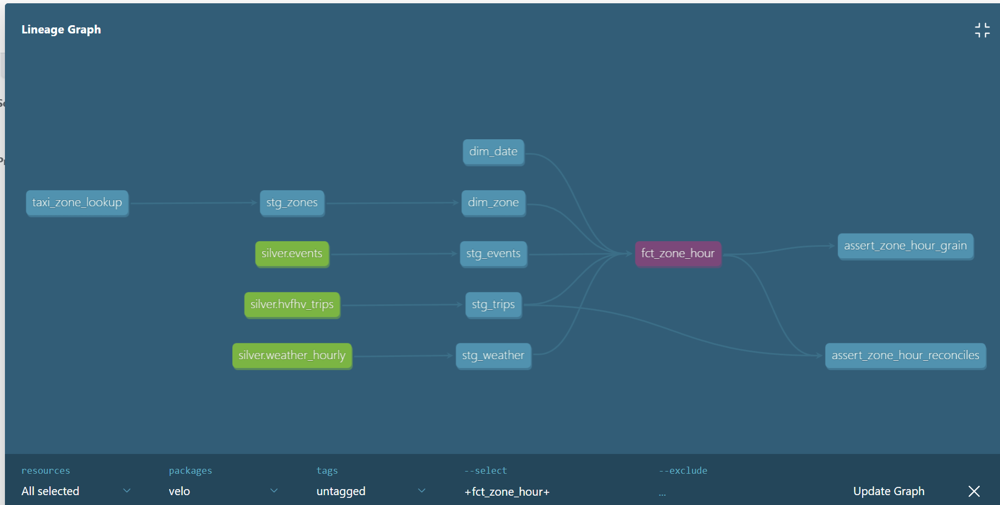

# Velo — Ride-Hailing Marketplace Intelligence Platform

End-to-end data platform that quantifies revenue lost to supply–demand mismatch in a ride-hailing marketplace, using ~20M real NYC TLC trips per month.

**Stack:** Airflow · Databricks (PySpark, Delta Lake, Unity Catalog) · dbt · AWS · Kafka · MLflow · Power BI

## Status
- [x] Phase 0 — Environment setup (Databricks, AWS S3/IAM, pre-commit, smoke test)
- [x] Phase 1 — Ingestion: 12 months of NYC HVFHV trips (~240M rows), hourly weather (Open-Meteo API), permitted events (NYC Open Data, paginated); orchestrated in Airflow 3
- [ ] Phase 2 — Lakehouse (bronze/silver) with PySpark + Delta
- [ ] Phase 3 — dbt modelling (gold)

## Phase 3 — Gold layer with dbt ✅

dbt project (`dbt/velo`) on Databricks SQL Warehouse, building a tested star schema on top of the silver Delta tables.

| Layer | Models | Materialisation |
|---|---|---|
| Sources | `silver.hvfhv_trips`, `silver.weather_hourly`, `silver.events` | Delta tables |
| Seed | `taxi_zone_lookup` (265 TLC zones) | table |
| Staging | `stg_trips`, `stg_zones`, `stg_weather`, `stg_events` | views |
| Marts | `dim_zone`, `dim_date`, `fct_zone_hour` | tables |

**`fct_zone_hour`**: one row per pickup zone per hour. 239.6M trips → 2.2M rows (~108× smaller), with demand, median/p90 wait, revenue, weather, events, holiday and congestion-pricing flags.

**Data tests (19):** unique / not_null keys, referential integrity (trips → zones), a custom grain test (zone + hour) and a reconciliation test (sum of fact trips = source trip count).

**Finding:** the uniqueness test on `trip_id` flagged 2,988 colliding keys. Investigation showed all 6,059 rows were distinct trips (99.7% differ in dropoff time, distance and fare): same driver, request and pickup time, so likely multi-rider pickups. Fix: extend the surrogate key, rather than deleting real trips.
